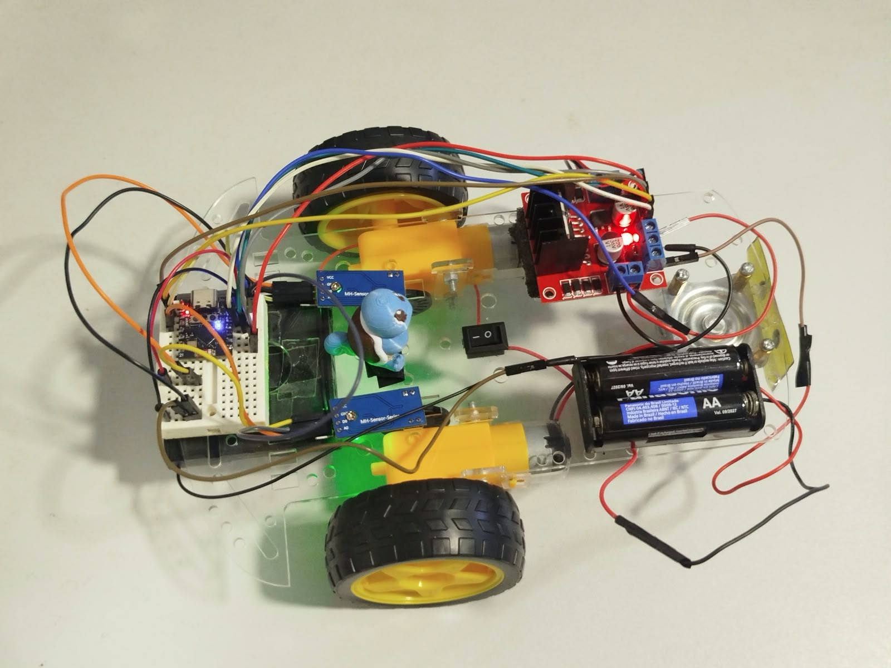
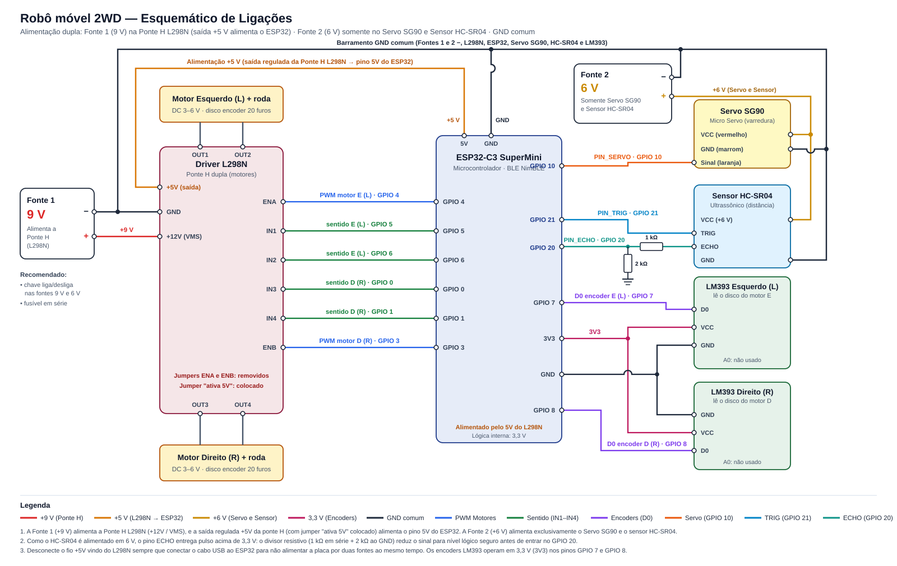

# Robotics Laboratory - 2WD Mobile Robot Control

**Controle de Posição de Robô Móvel**

Atividade prática: Desenvolvimento de uma plataforma robótica móvel de duas rodas, capaz de realizar deslocamentos retilíneos de 0 a 1 metro, concebida na disciplina de Robótica. Dessa forma, o objetivo é demonstrar e comparar o comportamento dos sistemas de controle em malha aberta e em malha fechada.

A plataforma receberá um sensor ultrassônico HC-SR04 e um servo motor SG90 para detecção de obstáculos.

## 📸 Foto do robô



## 🎥 Vídeo do robô

[](https://youtube.com/shorts/XsfopnlBCb8)

## Requerimentos

### Hardware
- Kit plataforma robótica 2WD
- ESP32-C3 SuperMini
- Discos encoders ópticos perfurados
- Módulo Sensor Encoder Óptico LM393
- Sensor Ultrassônico HC-SR04
- Servo Motor 9g - SG90
- Driver de motor: Ponte H L298N
- Sistema de alimentação: Baterias ou Fonte Externa
- Cabos jumper, chave liga/desliga e materiais de fixação

### Software
- Arduino IDE ou VS Code
- Suporte à placa ESP32 (Instalada via `Boards Manager`) se estiver no Arduino IDE
- Bibliotecas: **ArduinoJSON** e **NimBLEDevice**

## Estrutura do repositório

```
├── docs/
│   ├── 2ª-avaliação-de-robótica.pdf
│   ├── 3ª-avaliação-de-robótica.pdf
│   └── images/                         (fotos do robô, esquema elétrico)
│       ├── robot-car-front-view.png
│       ├── robot-car-top-view.png
│       └── robot-wiring-schematic.svg
├── ihm/
│   ├── index.html                 (Esqueleto e texto da IHM)
│   ├── css
│   │   └── style.css              (design e cores da IHM)
│   └── js
│       └── script.js              (Lógica e funcionamento da IHM)
├── robot_firmware/
│   └── robot_firmware.ino         (Versão do Arduino IDE)
├── src/
│   └── main.cpp                   (Versão do VS Code)
├── LICENSE
├── .gitignore
├── platformio.ini
└── README.md
```

## 💻 Instalação

O código para clonar localmente o repositório:

```bash
git clone https://github.com/pv-Chagas/uema-2wd-mobile-robot-control.git
```

### Opção 1: VS Code + PlatformIO

Se estiver usando PlatformIO no VS Code, o gerenciamento de bibliotecas é totalmente automatizado. 
O arquivo `platformio.ini` já contém todas as dependências mapeadas. Basta abrir a pasta do projeto no VS Code e clicar em **Build** (Compilar) - o PlatformIO fará o download das versões corretas automaticamente.

### Opção 2: Arduino IDE

Se estiver no Arduino IDE, baixe as bibliotecas manualmente:

1. Na IDE, pressione ``Ctrl`` + ``Shift`` + ``I`` para abrir o Gerenciador de Bibliotecas (ou acesse *Sketch > Incluir Biblioteca > Gerenciar Bibliotecas*).
2. Busque por **NimBLE-Arduino** (autor: h2zero) e clique em Instalar.
3. Busque por **ArduinoJson** (autor: Benoit Blanchon) e clique em Instalar.

## ⚡ Diagrama de fiação



## 🌐 Usar a IHM

1. Abra o arquivo `ihm/index.html` no navegador.
2. Para usar Bluetooth LE, utilize Chrome ou Edge em uma versão compatível com Web Bluetooth.
3. Clique em **Conectar**, selecione o dispositivo `Robo-SQUIRTLE` ou o nome configurado no firmware.
4. Também é possível conectar pela porta USB com uma velocidade de 115200 baud.

> A IHM pode ser usada em modo de simulação sem o robô conectado.

## Funcionalidades

- Controle em malha aberta e com controladores P, I, D, PI, PD ou PID.
- Comandos e telemetria por Bluetooth LE ou conexão USB serial.
- Interface web para selecionar o modo de controle, ajustar ganhos e acompanhar odometria.
- Registro de até 30 segundos de dados de telemetria na memória do ESP32.
- Condução manual, varredura por servo e leitura de distância com HC-SR04.

## Possíveis problemas e soluções

- **O robô não aparece na busca BLE:** confira o nome em `BLE_NAME`, aproxime os dispositivos e feche outras conexões abertas.
- **Não há comunicação USB:** confirme o modo **USB CDC On Boot**, selecione a porta correta e use 115200 baud.
- **O robô move-se na direção errada:** troque o sentido dos motores no hardware ou ajuste `INVERT_LEFT` e `INVERT_RIGHT` no firmware.
- **HC-SR04 gera leituras incorretas:** confira o divisor de tensão no pino `ECHO` e a alimentação de 5 V do sensor.

## 👥 Colaboradores

| [](https://github.com/pv-Chagas) | [](https://github.com/RayaraOliveira) | [](https://github.com/marcosgsc22) | [](https://github.com/pvitor-eng) | [](https://github.com/GrazySilva17)
|---|---|---|---|---|